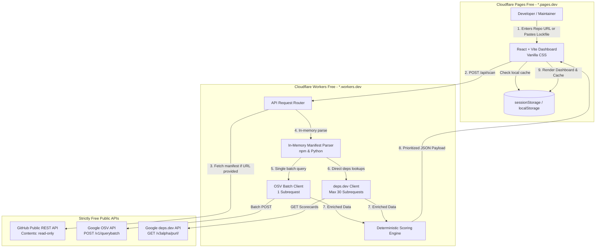

# Requirements & Refined System Architecture (Strict ₹0 Budget)

This document specifies the refined functional/non-functional requirements, data flow, component architecture, and scoring algorithm for Veylix under the strict ₹0 operating model.

---

## 1. Functional Requirements (FR)

* **FR-1: Manifest & Lockfile Parsing (npm & Python):**
  * Support npm manifests (`package.json`, `package-lock.json`, and `pnpm-lock.yaml`).
  * Support Python manifests (`requirements.txt`, `poetry.lock`).
  * Extract package names, current versions, and resolved target versions strictly in-memory.
  * Never clone repository source code or write customer code to disk.
* **FR-2: Batch Vulnerability Matching (Google OSV API):**
  * Batch all extracted dependencies into a single HTTP POST request to `https://api.osv.dev/v1/querybatch` (consuming only 1 Cloudflare subrequest).
  * Parse returned CVE/GHSA identifiers, CVSS severity levels, affected version ranges, and fixed versions.
* **FR-3: Maintenance Vitality Enrichment (Google deps.dev API):**
  * Query `api.deps.dev/v3alpha/purl/` for direct dependencies (capped at $\le 30$ subrequests per invocation to protect Workers limits).
  * Extract project `Maintained` score (0–10), last release date, and license info.
  * If deps.dev returns HTTP 429 or no Scorecard exists, fallback gracefully to neutral vitality defaults without failing the scan.
* **FR-4: Transparent Risk Prioritization:**
  * Calculate an itemized **Veylix Risk Score (0–100)** for each dependency.
  * Assign deterministic priority tiers:
    - 🔴 **IMMEDIATE:** Active CVE advisory with fixed patch or unmaintained dependency.
    - 🟡 **HIGH:** Known CVE with clear upgrade path, or abandoned core dependency.
    - 🟠 **MAINTENANCE_WARNING:** Dependency unmaintained $>18$ months or OpenSSF Maintained score $<3/10$, but no known CVE.
    - 🟢 **HEALTHY:** Actively maintained, no open advisories.
* **FR-5: Interactive Web Dashboard (React + Vite + Vanilla CSS):**
  * Single-page application hosted on Cloudflare Pages (`*.pages.dev`).
  * Displays repository aggregate health score, risk breakdown chart, and searchable triage queue.
  * Allows users to input public GitHub URLs or paste lockfiles directly for zero-friction analysis.

---

## 2. Non-Functional Requirements (NFR)

* **NFR-1 (Strict Zero Cost):** All infrastructure must execute within Cloudflare Workers Free and Cloudflare Pages Free quotas. No paid services, paid APIs, or overage-eligible accounts.
* **NFR-2 (Subrequest Ceiling):** Total external HTTP fetches per scan invocation must strictly remain under **40 subrequests** (well within Cloudflare Worker's 50 subrequest limit).
* **NFR-3 (Execution Time & Memory):** Manifest parsing and score calculation must complete within **10 ms active CPU time** and **128 MB RAM**.
* **NFR-4 (Zero Code Retention & Privacy):** Raw manifest contents are parsed ephemerally and discarded immediately after generating the dependency tuple array.
* **NFR-5 (Graceful Degradation):** Under API rate-limiting or quota exhaustion, the system must degrade to cached results, vulnerability-only mode, or polite informational notices—never presenting paywalls or upgrade screens.

---

## 3. Refined System Architecture



---

## 4. Prototype Data Flow (Stateless In-Memory Model)

Rather than maintaining a persistent database (Cloudflare D1 deferred to Phase 2), the prototype operates with a lightweight, transient TypeScript interface:

```typescript
export interface DependencyFinding {
  name: string;
  ecosystem: 'npm' | 'pypi';
  currentVersion: string;
  latestVersion?: string;
  advisories: {
    id: string; // CVE or GHSA
    severity: 'CRITICAL' | 'HIGH' | 'MODERATE' | 'LOW';
    summary: string;
    fixedVersion?: string;
  }[];
  vitality: {
    maintainedScore: number | null; // 0-10 from OpenSSF
    daysSinceLastRelease: number | null;
    isAbandoned: boolean;
    license?: string;
  };
  veylixScore: number; // 0-100 risk score
  priorityTier: 'IMMEDIATE' | 'HIGH' | 'MAINTENANCE_WARNING' | 'HEALTHY';
}

export interface ScanResult {
  repository?: string;
  timestamp: string;
  overallHealthScore: number; // 0-100 (100 = optimal health)
  totalDependencies: number;
  criticalIssuesCount: number;
  maintenanceRisksCount: number;
  findings: DependencyFinding[];
}
```

---

## 5. Prioritization Algorithm Specification

The **Veylix Risk Score** per dependency is computed as:
$$\text{Risk Score} = \min(100, S_{\text{vulnerability}} + S_{\text{vitality}})$$

### Component Scores:
1. **$S_{\text{vulnerability}}$ (0 to 100):**
   * Critical Severity CVE: $80\text{ pts}$
   * High Severity CVE: $55\text{ pts}$
   * Moderate Severity CVE: $30\text{ pts}$
   * Low Severity CVE: $15\text{ pts}$
   * No Known Advisory: $0\text{ pts}$
2. **$S_{\text{vitality}}$ (0 to 40):**
   * OpenSSF Maintained score $< 3.0$ or flagged unmaintained: $+25\text{ pts}$
   * Days since last release $> 730\text{ days}$ ($>2\text{ years}$): $+15\text{ pts}$
   * Active release within last 90 days: $0\text{ pts}$

### Tier Assignment:
* $\ge 75$: 🔴 **IMMEDIATE** (Requires attention this sprint)
* $45 - 74$: 🟡 **HIGH** (Scheduled upgrade)
* $20 - 44$: 🟠 **MAINTENANCE_WARNING** (Track for migration / deprecation)
* $< 20$: 🟢 **HEALTHY** (Routine dependency)
