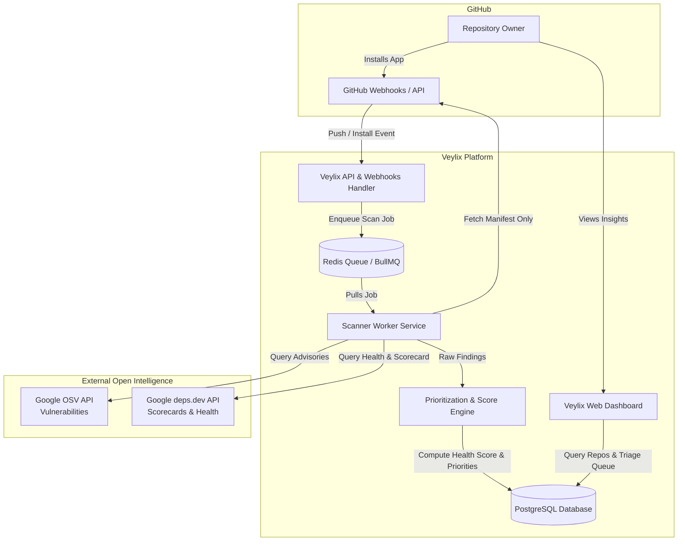
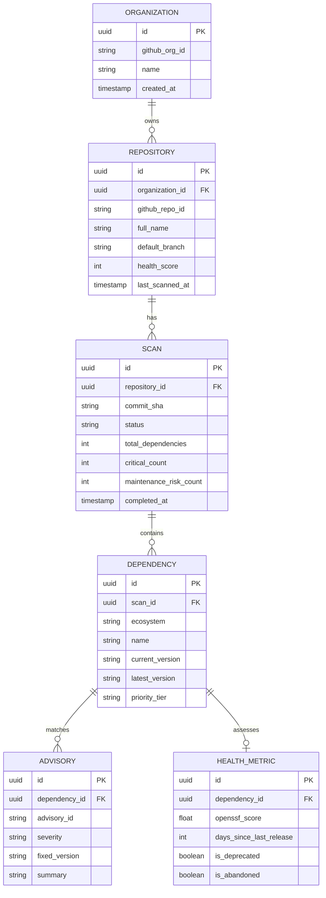

# Requirements & System Architecture Plan

This document details the functional and non-functional specifications, system architecture, data models, and scan lifecycle for Veylix.

---

## 1. Functional Requirements (FR)

* **FR-1: GitHub App Integration:**
  * Authenticate users using GitHub OAuth.
  * Receive and handle installation webhooks (`installation`, `installation_repositories`).
  * Ingest `push` events to trigger scans when manifest files change on the default branch.
* **FR-2: Manifest Detection & In-Memory Parsing:**
  * Support `package.json` + `package-lock.json` / `pnpm-lock.yaml`.
  * Support `requirements.txt` / `poetry.lock`.
  * Extract package names, current versions, and semantic version constraints.
  * Never persist source files to disk.
* **FR-3: Threat Intelligence Enrichment:**
  * Batch query OSV API (`api.osv.dev`) for all extracted package versions.
  * Extract CVE IDs, GHSA IDs, severity level, affected range, and fixed versions.
* **FR-4: Maintenance Health Enrichment:**
  * Query `deps.dev` / OpenSSF Scorecard API for package health signals:
    * Project `Maintained` score (0–10).
    * Days since last package release.
    * Open issues / commit activity trends.
* **FR-5: Prioritized Triage Engine:**
  * Calculate repository composite health score (0–100 scale).
  * Assign priority tags:
    - `CRITICAL`: Active advisory with known exploit or abandoned maintainer.
    - `HIGH`: Known vulnerability with safe patch available.
    - `MAINTENANCE_RISK`: Library abandoned >18 months or unmaintained score <3/10.
    - `LOW`: Routine upgrade available, library healthy.
* **FR-6: Repository Dashboard & Triage View:**
  * View connected repositories and their aggregate health scores.
  * Filter and sort issues by priority tier, ecosystem, and status.
  * Detail modal showing advisory descriptions, Scorecard breakdown, and suggested resolution.

---

## 2. Non-Functional Requirements (NFR)

* **NFR-1 (Security & Privacy):** Zero code retention. Strictly ephemeral parsing of manifest files.
* **NFR-2 (Performance):** Complete full dependency scan and enrichment for a 100-package repository in under 5 seconds.
* **NFR-3 (Scalability):** Asynchronous worker queues for scanning to prevent blocking webhook responses or web API requests.
* **NFR-4 (Reliability):** Implement exponential backoff for external API queries (OSV, deps.dev, GitHub API) to handle transient rate limits or outages gracefully.

---

## 3. High-Level System Architecture

---

## 4. Conceptual Data Schema

---

## 5. Prioritization Algorithm Logic

The **Veylix Risk Score** per dependency is computed as:
$$\text{Risk Score} = w_v \cdot S_{\text{vulnerability}} + w_m \cdot S_{\text{maintenance}} + w_e \cdot S_{\text{exposure}}$$

- **$S_{\text{vulnerability}}$ (0 to 100):** Based on CVSS base score or severity: Critical = 100, High = 75, Medium = 40, Low = 15, None = 0.
- **$S_{\text{maintenance}}$ (0 to 100):** Based on OpenSSF Scorecard `Maintained` subscore and release staleness:
  - Last release > 2 years ago or marked unmaintained: +50 points.
  - OpenSSF Scorecard < 4.0: +30 points.
  - Active commits within 30 days: 0 points.
- **Priority Tier Classification:**
  - $\ge 80$: 🔴 **Immediate**
  - $50 - 79$: 🟡 **High**
  - $25 - 49$: 🟠 **Maintenance Warning**
  - $< 25$: 🟢 **Healthy**
